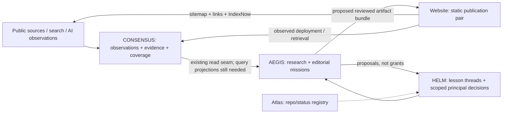

# Research + SEO Publication Engine — source reconciliation

Audit: 2026-09-27 America/New_York (live HTTP checks continued at 2026-09-28 01:29 UTC).
Status: **reconnaissance complete within the declared source/read-only measurement scope; bounded indexing correction prepared, not deployed**.

## 1. Executive finding

Preserve the proposed ownership boundary. CONSENSUS already implements the observation/evidence plane; AEGIS implements reusable research and orchestration; ShaneStrough.com implements the publication surface. HELM already supplies evidence-backed publication nominations and principal authority. The missing engine is chiefly the connection between those existing systems, explicit editorial selection, and publication lifecycle/feedback contracts—not a new search warehouse.

SIGNAL and MIRROR are code, not speculative modules. The newer CONSENSUS Fabric also runs bounded collection, evidence custody, coverage, first-party enumeration and resolution. Conversely, a local MIRROR reader is not a measurement of ChatGPT, Gemini, Perplexity or other public AI products. Generic Google Indexing API submission is a real defect and is removed on this branch.

Evidence key below identifies exact implementations. “Not found” throughout means not implemented in the inspected source trees, not proof that no private external service or unexamined branch exists. Existing documentation's production claims are distinguished from measurements performed here. No private AEGIS memory, personal CONSENSUS findings, credential values, or live database content was inspected/exported.

## 2. Current architecture map and source baselines

| System | Inspected baseline | Responsibility and evidence |
|---|---|---|
| CONSENSUS | `ba501dd12536fe2d9c402213bfc6f1ad039bf8d1` | Public observation, provenance, desired/observed authority, commissioning; C1–C7 |
| AEGIS | `2e51b8aa063fda9e82c7764159bbcb4aee0aeae9` | Research, tier-safe reasoning, goals/tasks, operator actions; A1–A5 |
| Website | `7fe2bd235c4eaaa2300bc91a0e7d013cd5b913b0` plus separately inventoried pre-existing dirty files | Static publication and discovery execution; W1–W4 |
| Requested historical `shane-thomas-strough/Elevare-Edge` | `3982d0125151c64a4941c83b60bca0af13f6e229`, fetched read-only to `/tmp/research-engine-elevare-edge` | Static landing pages, APEX SQL/contracts and infrastructure manifests; E0 |
| Current `ElevareEdge/elevare-edge-official` | `a697796c33808474e3ccee1c604261948e2daca3` | Contractor business intelligence, acquisition, evidence/visibility scoring; E1–E3 |
| HELM | `f629d10fda38821551c73029bdeb8b83a1c6f610` | Portfolio decisions, lesson threads, publication authority/history; H1–H2 |
| project-atlas | `e0197848dd4ed698c54c20d1aacff5a69dfc3a9f` | Repo atoms and generated portfolio views; P1 |

The historical and current Edge repositories are distinct. The historical repo has no AGENTS/CLAUDE/STATUS/BACKLOG/CHANGELOG files in the fetched tree and no implemented search warehouse. Its declared API routes are specifications, not server implementation. Do not substitute its generic `metrics_daily`/agent workflow SQL for CONSENSUS.

## 3–5. Existing, partial and unimplemented capabilities

| Required capability | Current evidence-backed state | Missing portion / owner |
|---|---|---|
| 1 SEO/discovery/search intelligence | C1 LENS/SIGNAL, C4 Fabric, W1 metadata/sitemap/robots, E3 public-site JSON-LD | Integration and measured editorial feedback; CONSENSUS + AEGIS |
| 2 Keyword/query intelligence | C2 Query text, observer profile, system, timestamped result observations; A2 generated research subqueries; static HTML keywords are incidental | Target families, intent, demand metrics, trends and topic relationships; CONSENSUS observed intelligence, AEGIS editorial targeting |
| 3 SERP observation/history | C1 records ordered SearXNG results, engine names, owned/named hits, failures, history; A3 Sentinel has its own result history | Consolidation, licensed/commissioned engine coverage and comparable engine/device/locale semantics; CONSENSUS |
| 4 Search Console | Website documentation claims property ownership and sitemap setup; no property verification or analytics API ingest demonstrated; C7/A1 explicitly defer | Actual authorized property access and paginated query/page/date metrics, inspection records; CONSENSUS |
| 5 Bing/IndexNow | W2 committed key and live-notification workflow; indexing acceptance not measured here | Deployment-ordered canonical submission receipts; website. Bing Webmaster observations; CONSENSUS |
| 6 AI/GEO measurement | C3 local reader over first-party and search-retrieved material, claim verdicts, citation indices, history | Public AI provider/prompt-family citation measurements, no-context probes and calibrated attribution; CONSENSUS |
| 7 Entity/claim graph | C2 Entity, Property, Claim, Relationship, Representation, Citation; graph UI; TRACE and desired visibility | Article/topic/query relationships and third-party representation capture coverage; CONSENSUS |
| 8 Structured data | W1 inline JSON-LD; W3 pair generator; C5 extraction/parse findings and commissioning; E3 shared JSON-LD rendering | Publication metadata validation, author identity consistency, pair semantics, semantic schema validation; website authoring, CONSENSUS observed commissioning |
| 9 Publication workflow | W1 direct HTML + GitHub Pages; W3 one-off pair build; A4 staging/approvals primitives; H1 decisions | End-to-end approved artifact → deployment receipt → observation lifecycle; AEGIS and website |
| 10 Research-topic discovery | W4 coming-soon list; A2 Deep Research; H1 lesson-thread radar and hypotheses | Merge research nominations with measured demand, novelty checks and editorial decision records; AEGIS |
| 11 Topic/keyword scoring | A1 historical five-factor formula is design/backlog, no executable Press score located; E1 implements a different nine-component business score | Explicit SEO opportunity model and separate editorial gate; AEGIS |
| 12 Internal-link intelligence | C5 extraction/counts/link samples; W1 hand-authored links and reciprocal companions | Full observed graph/opportunities in CONSENSUS; editorial link recommendations in AEGIS; approved edits on website |
| 13 Competitor/gap analysis | C1 diagnosis/collision candidates and non-owned result hosts; E1 geographic/niche research and peer comparisons | Research-topic/SERP competitor content gaps with evidence; CONSENSUS observations, AEGIS interpretation |
| 14 Publication-performance feedback | C1 position time series and C3 representation history; W2 notifications only; Roxy analytics stubs A5 | Query/page/click/CTR/position feedback joined to interventions; CONSENSUS measurement and AEGIS learning |
| 15 Backlink/citation monitoring | C6 TRACE over stored representations; C1 citation ladder and third-party result heuristics | Comprehensive backlink index, external citation capture and public-AI attribution monitors; CONSENSUS |
| 16 Query clustering | No implementation found in C/A/Edge source; H1 lesson threads and website category filters are useful equivalents for topic grouping, not query clusters | Versioned query-family/intent/SERP clustering; CONSENSUS, consumed by AEGIS |
| 17 Scheduled automation | C7 daily SIGNAL/MIRROR unit; measured active timer today. A4 recurring tasks and A3 weekly cron recipe; Edge pg-boss sweeps | Weekly editorial nomination/research cycle; AEGIS. No weekly publication job commissioned |
| 18 Existing data models | C2/C4; A2/A4; H1/H2; E2 | Reuse before schema additions; details §15 |
| 19 Genuine gaps | No wired selection→paired-artifact→approval→publish→performance-learning loop found | Staged work, not wholesale build |
| 20 Missing-capability ownership | See §7 and §17 | One observation owner, one research orchestrator, one approved publication surface |

## 6. Duplicates and overlaps

* **SERP:** AEGIS `aegis_sentinel.serp_results` and CONSENSUS SIGNAL both observe search. A1 explicitly kept Sentinel only until MIRROR existed. That condition now holds. Preserve Sentinel alerts/history while moving new collection ownership through a compatibility projection; do not delete the old table or silently rewrite observations.
* **RDAP:** AEGIS retains a deprecated compatibility watch; CONSENSUS SHADOW is the observation owner (A1/A3).
* **Query warehouse:** A1 leaves PRESS-3 in AEGIS even though subsequent SIGNAL owns the warehouse. Reconcile by keeping editorial target/mission references in AEGIS and observed queries/results in CONSENSUS.
* **Experiments:** A1 plans a Press experiment ledger; C2 already has `Experiment`. Reuse CONSENSUS interventions/retests for observed effects; AEGIS may hold research plans and hypotheses, linked by ID, not duplicate measurement facts.
* **“Visibility” scores:** Edge E1 scores observed listing/license/review completeness. It explicitly does not predict search rankings or AI recommendations. It is prior art for unknown handling, not a GEO metric to reuse as Shane's score.
* **“Publication”:** C4 `Publication` seals a mission result and artifact manifest. H2 publication records preserve a historical event. Neither is an article-pair metadata schema. Keep names/contracts distinct.
* **Poetry copies:** 12 root poems also exist under `Poetry/`; aliases declare root canonicals, while their relative navigation often resolves to missing nested pages (inventory).

## 7. Ownership map

**CONSENSUS:** authorized search/query observations, SERP snapshots, engine provenance/coverage, GSC/Bing metrics and URL inspection, demand-source observations, query clustering, observed links/backlinks/citations, AI prompt/result measurement, claim/entity graph, public publication enumeration, performance history, commissioning and retests. Observation failures and unavailable credentials remain unknown, not zero.

**AEGIS:** editorial target selection, five-factor opportunity interpretation, separate merit gates, topic/research mission briefs, Sasha-led research and synthesis, falsification/validation work, pair drafts, Roxy distribution proposals, scheduling, operator interaction and proposed actions. Research web search remains a research tool; it must not become a second persistent SEO warehouse.

**Website:** versioned public metadata/HTML/assets, canonical pair URLs, reciprocal links, source/citation presentation, honest structured data, sitemap/robots, approved deployment and IndexNow receipt capture. No search warehouse or autonomous opinion generator.

**HELM:** existing lesson nominations, thread provenance, scoped principal authority, portfolio choices and published-event history. AEGIS staged actions execute within those decisions; they do not invent a competing grant of authority. H2 currently covers lessons, not arbitrary article hashes: extending it requires an explicit contract.

**Atlas:** canonical repository/status/capability records and generated views, not editorial workflow state. This branch is pending source work, so no live capability or deployment claim is promoted in the registry.

**Edge:** retains contractor-specific lead/market/review intelligence and commercial workflows. Consumers may eventually use CONSENSUS public-state evidence; no migration of its business database is justified by this mission.

## 8. ShaneStrough.com health

Read-only local census: **38 HTML files**, comprising **24 root pages (one untracked draft)** and **14 under `Poetry/`**. All 38 have a title, description, canonical, Open Graph title, Twitter card and parseable JSON-LD. This proves presence/JSON syntax, not semantic validity, rich-result eligibility, rendering performance, accessibility or rankings. No new rendered/Core Web Vitals audit was performed.

The committed baseline has 37 HTML files and 26 sitemap entries. The pre-existing working tree has 38/27 because Bake-Off was already in progress. The live sitemap fetched here has 26 URLs; robots allows all and declares it. Main findings:

* `/poetry.html` and `/press.html` are in the live sitemap and are canonical targets of the nested source pages, but both return **404**. Root navigation repeatedly points to the missing poetry hub.
* 159 missing local href/src references across the working tree (occurrences, not 159 unique destinations), mostly nested Poetry navigation and root poetry-hub links. This is a filesystem check; only the two URLs above were confirmed live 404s.
* Five gallery image references point to absent local files; nested Press adds incorrect relative image paths. Inventory preserves exact names.
* Sitemap includes both the bare homepage and `/index.html`, despite a bare-domain canonical. Do not treat aliases as independent publications.
* The hub's Published counter still says 5 although the committed published list contains seven entries. Working-tree Bake-Off makes eight; that is not evidence it is approved/live.
* `_build/build_pages.py` embeds an obsolete temporary scratchpad path plus absolute Downloads/site paths. It produced the existing pair but is not a reproducible general publication pipeline.
* Broad robots ALLOW is the implemented crawler policy. It does not encode separate search-vs-training bot decisions; PRESS-12 still names that decision.

Evidence: [full raw inventory](site-inventory.json), W1/W3/W4; live GET Stale State, sitemap and robots = 200; live HEAD Poetry and GET Press = 404. Search analytics, backlinks, traffic, indexing coverage and current rankings remain unknown. Historical CONSENSUS rankings in STATUS are dated observations, not fresh measurements.

## 9. Keyword/query intelligence

SIGNAL is the reusable starting point, including arbitrary provided query strings—not only hardcoded brand names. Its configured daily pass uses declared entity/name query sets. Results contain text, URL, position, snippets, contributing engines and owned-property hits. `Query` links to immutable observations. `history()` groups by query/system and derives appearance/disappearance without asserting causality.

Limit: these are metasearch response positions, not a validated universal Google rank. `observer_profile` is currently a string; explicit locale/device/language, impression/click metrics, measured volume, trend series, intent and cluster membership are not implemented there. AEGIS query expansion helps answer a research question; it is not measured search demand. No fabricated volumes should enter the opportunity model.

The Fabric has commissioned-provider policy distinct from legacy SIGNAL. Its documented `wiby` limitation must not be generalized to every search path: legacy SIGNAL, AEGIS SearXNG and Brave research are different paths. The differing policy/coverage contracts should be reconciled before broad unattended demand collection (C1/C4, A2/A3).

## 10. Search Console / SERP / IndexNow / Google indexing

W2's original workflow submitted every changed HTML URL to the Google Indexing API, with a service-account JWT. Google currently restricts that API to JobPosting or BroadcastEvent within VideoObject. The website's ordinary article markup is not eligible. A homepage VideoObject alone does not establish livestream eligibility.

Official sources checked during this mission:

* [Google Indexing API restriction](https://developers.google.com/search/apis/indexing-api/v3/using-api) — documentation updated 2026-07-16.
* [Google sitemap guidance](https://developers.google.com/search/docs/crawling-indexing/sitemaps/build-sitemap).
* [Search Console sitemap submission API](https://developers.google.com/webmaster-tools/v1/sitemaps/submit).
* [Search Console API service boundaries](https://developers.google.com/webmaster-tools/v1/api_reference_index).
* [IndexNow protocol](https://www.indexnow.org/documentation).

Correction: remove generic Google notification and secret use; keep IndexNow; state acceptance separately from indexing; fail non-200/202 IndexNow responses; bound request time. Google uses valid sitemap/crawl/internal-link mechanisms and authorized Search Console management. No replacement API call was installed merely on an assumption that existing credentials have the correct scopes/property access.

Remaining workflow defects, explicitly outside this bounded correction: push-trigger races Pages deployment; HEAD~1 diff misses earlier commits in a multi-commit push; it enumerates path URLs rather than canonical/sitemap-approved URLs; both homepage aliases can be submitted; deletions are not handled; cancelling concurrent runs may drop pending notifications. Next workflow phase should consume successful deployment receipts, diff from the last successfully notified deployment, submit canonical published URLs, and persist truthful receipts. Never infer index inclusion from notification success. Credentials/configuration and past remote workflow success were not audited.

## 11. AI/GEO state

MIRROR runs an actual local model reader (`qwen2.5:14b` default), with first-party and retrieval contexts, expected claim objects, observed/error states, prompt/method/model provenance and answer citations. Comprehension benchmarking and controlled-claim checks exist. The SIGNAL ladder separately leaves machine citation `unobserved` where no observer exists.

These are valuable machine-comprehension tests, not market-wide AI visibility. Missing: commissioned external AI observers, explicit prompt families/versions, geographic/account context, citation URL normalization, repeat sampling and per-provider uncertainty. No single “GEO score” should collapse correctness, retrieval, citation and attribution. Source: C1/C3 and tests.

## 12. Publication-engine state and loop mapping

| Loop stage | Current reusable mechanism | Integration gap |
|---|---|---|
| Observe | SIGNAL/LENS/MIRROR/Fabric | Demand metrics and publication-specific coverage |
| Discover | HELM lessons/threads, website pipeline, Sasha research | One evidence-backed nomination inbox |
| Cluster | HELM threads, website category filters | Query clustering and crosswalk to topics |
| Score | SEO Press formula in design; Edge business-score prior art | Versioned opportunity components + editorial gate |
| Select research mission | AEGIS goals/operator interaction | Durable editorial selection reason and linked observation IDs |
| Research | AEGIS research/Sasha; CONSENSUS bounded public evidence collection | Publication research brief and artifact/evidence references |
| Validate | Existing provenance, standing and commissioning; tests | Editorial originality, falsification, calculations and citation review |
| Produce pair | Existing manual Horizon/Stale State pair | Reproducible paired-artifact builder and metadata |
| SEO/GEO package | Existing HTML/schema/links/sitemap | Enforced package checks and observer retest plan |
| Principal approval | AEGIS staged actions; HELM scoped lesson decisions | Exact artifact revision/hash authorization contract |
| Publish | GitHub Pages | Approval-bound deployment receipt |
| Discover/index | IndexNow + sitemap/links | Deployment ordering and valid receipt semantics |
| Measure | CONSENSUS observations/history | URL/query/pair joins with GSC and AI observations |
| Learn | Human interpretation and evidence history | Recorded before/after learning feeding next nomination |

This is an implemented set of components, not an implemented continuous publication engine. A weekly **review/research opportunity** is a sensible future schedule; weekly publication is conditional on gates, never a quota.

## 13. Topic discovery and opportunity lineage

Recover A1's original `relevance × authority_gap × economic_value × achievability × strategic_fit`. No executable five-factor Press scorer was found. Edge's existing scorer uses nine weighted market/niche/acquisition components and confidence thresholds; transplanting it would silently change the meaning of publication opportunity.

Proposed AEGIS decision record keeps two independent objects:

1. **Search opportunity:** five named factors, version, evidence references, observation window, known/unknown standing and rationale. Normalize factors only when their measurement rubric is declared. If a necessary factor is unknown, the product is unknown; never fill with invented volume or a neutral value that looks measured.
2. **Editorial merit:** originality, evidence availability, legitimate experience/authority, timeliness, researchability, falsifiability (or explicit not-applicable reason), strategic coherence and pair potential. Each has pass/fail/unknown plus evidence/reviewer rationale. Blocking failures cannot be overcome by a high search score.

High demand + no original contribution: reject/defer publication. Low immediate demand + strong novel evidence/coherent thesis: allow a separately justified research-led nomination for principal review. Keep economic opportunity advisory rather than a veto on research-led work. HELM lesson-thread radar is an existing source of exactly this sort of earned evidence (H1).

## 14. Publication inventory and pair support

Published-list evidence means listed as published in committed HTML, not independently validating authorship claims, experiments or all external URLs.

**Research/practitioner publications:**

| Artifact | Location/state |
|---|---|
| Mitigating Logistical Risks in International Mission-Critical Construction | External Medium URL in `insights.html` |
| The Anatomy of a Zero-Downtime Cutover in Live, Mission-Critical Facilities | External Medium URL in `insights.html` |
| Siemens Building Automation Systems — Data Center Commissioning Field Guide | `field-notes-siemens-bas.html`; source guide in `field-notes/` |
| Stop the Chaos: Why Nuclear-Grade Communication is the Ultimate Data Center Control | `podcast-stop-the-chaos.html`; captions/media support |
| What Building Blue Origin's Launch Infrastructure Taught Me About Mission-Critical Systems | `field-notes-blue-origin.html`; DOCX source in `field-notes/` |
| The Comprehension Horizon | `the-comprehension-horizon.html`; accessible essay, live retrieved |
| Stale State: Measuring Institutional Clock-Speed Against Frontier AI Cadence | `stale-state.html`; measurement companion, live HTTP 200 |
| The Bake-Off: Why the Session That Knew Everything Checked Least | Pre-existing untracked `the-bake-off.html` + `_build/bake-off-final.md`; dirty hub/sitemap entry. Not included or published by this mission |

Horizon and Stale State are a genuine pair already: distinct intents, reciprocal byline/body links, separate canonical URLs, TechArticle JSON-LD, shared author identity, hub entries and source masters. There is no explicit stable pair/mission identifier or structured companion relation in their JSON-LD. Body sources and falsification/deficiency sections exist, but this audit did not independently reproduce their research claims.

**Eight pipeline items, not published articles:** OT/IT field/network integration (`OT_IT_Integration.md`); offline documentation (`Offline_Documentation.md`); high-angle aerospace (`High_Angle_Aerospace.md`); air-gapped AI (`Air_Gapped_AI.md`); FOUND methodology (`FOUND_Methodology.md`); precision communication (`Master_the_Flow.md`); full-stack AI ecosystem (`Full_Stack_AI_Ecosystem.md`); AI assurance/security (`AI_Security_Assurance.md`). Exact displayed titles and source paths are in W4 and inventory.

**Twelve poetry works:** The Accent of the Soul; The World In Their Bodies; GINA; LAYNE; MERRIC; NAVIGATING: A Triptych; Nobody Leaves Hungry; The Orchard; SHANE; Singular; TRISTAN; Worth Not Leaving. Each has a root `poetry-*.html` and nested duplicate. `Poetry/poetry.html` is the collection, `Poetry/press.html` the media kit, both targeting missing root URLs. Poetry Markdown includes the Accent backstory; treat it as source material, not a separately established canonical article.

**Other surfaces:** homepage, About, CV, Insights collection, Gallery and Private Family Estates service page. These are public execution/entity/service surfaces, not additional research articles. Every HTML file and every Markdown/DOCX source is enumerated in `site-inventory.json`; assets/captions are supporting files, not counted as publications.

Future website metadata should hold `publication_id`, `research_mission_ref`, `pair_id`, role, canonical, headline, author/entity refs, topic refs, source/evidence refs, companion IDs and revision identity. AEGIS owns drafts and gates; website owns accepted public metadata; CONSENSUS observes it. Add schema.org relationships only when they accurately describe the works, not invented citation relationships.

## 15. Data models to reuse

* **CONSENSUS legacy store:** Entity/Property/Source/Observation/Query/Claim/Representation/Citation/Relationship/Finding/Remediation/CommissioningRequirement/CommissioningTest/Snapshot/Experiment. Observation IDs, time, layer, standing, tier and authorization remain mandatory seams (C2).
* **CONSENSUS mission store:** Mission/MissionRun/MissionEvent, Evidence, Capture, Coverage and sealed-result Publication. Reuse raw bytes/digests, provider identity, budgets and coverage instead of storing untraceable scraped summaries elsewhere (C4). The authored pair references this evidence; it is not this `Publication` type.
* **AEGIS:** `aegis_runtime.research_reports` (sources/subqueries/report), goals (plan/steps/staged actions), scheduled_tasks, artifacts and approvals. Extend with publication-mission associations and explicit editorial state only after freezing the cross-system contract (A2/A4).
* **HELM:** existing authoritative decision references, frozen lesson sets, publication history and derived threads. Current lesson scope is not an implicit grant over future article revisions (H1/H2).
* **Edge:** market evidence, research runs, niche opportunities, prospect pools, scoring weight sets and evidence snapshots remain contractor-domain records. Reuse design lessons, not those tables as the personal editorial database (E1/E2).

## 16. Defects and discrepancies

Priority order:

1. Generic Google Indexing API use and incorrect “all engines/no manual steps” claims — **corrected on branch**.
2. Live missing Poetry/Press canonical pages — measured, unfixed here; restore source-backed routes or deliberately redirect/remove after choosing canonical policy.
3. Stale architectural statements: AEGIS A1 calls MIRROR planned and retains query warehouse ownership; CONSENSUS STATUS contains an old “Fabric not built” paragraph followed by a deployed implementation section. Code/tests and dated newer sections settle current behavior. Record this reconciliation; do not infer absence from the old paragraphs.
4. IndexNow submission/deployment/diff/canonical limits (§10); improved failure reporting, remaining gaps retained.
5. Broken nested navigation/gallery assets, stale publication count, nonportable pair builder (§8).
6. Read seam currently returns estate/findings/claim projections and retrieval, not a complete query/history/coverage packet. Existence of a seam does not establish sufficient publication-intelligence access (C6).
7. Cross-tier boundary: CONSENSUS seam is max-tier 1; private findings cannot be sent as public research input. A safe public evidence projection is a prerequisite, not an implicit up-tier.
8. HELM focused tests exposed a date-zone defect: `test_source_identity_survives_aggregation` expects UTC today while `lessons.py:129` uses Git `%cs` (commit local date). 2026-09-27 EDT vs 2026-09-28 UTC failed; rerunning that test with `TZ=UTC` passed. No HELM fix claimed.
9. `research.py` carries last coverage on function attributes shared across invocations. This is a potential concurrent-research coverage race by code inspection, not a reproduced failure in this mission; address with per-run state before concurrent publication research.

## 17. Recommended target architecture

Extend the existing seams, do not wire direct cross-database reads. CONSENSUS exposes a tier-safe, provenance-bearing **publication-intelligence projection** with query text/family/intent, observed URL, engine/context, time, evidence refs and coverage; unavailable demand/GSC/public-AI data remains explicit. AEGIS consumes references and builds an editorial mission, joined to HELM nominations. Neither AEGIS nor the site clones observations.

Selected missions produce two complementary drafts and a validation packet. A principal reviews exact artifacts and source/evidence disclosure. The approval must bind finite revision scope (ideally artifact hashes), and a changed artifact invalidates that approval. Reuse HELM's authoritative decision seam and AEGIS staging; do not mistake current lesson-only grants for implemented article approval.

After approval, website deployment emits URL/revision/deployment receipts; IndexNow follows verified deployment. CONSENSUS observes crawling/indexing/retrieval/representation as separate states and joins measurements to the intervention/pair. AEGIS records learning, uncertainty and changed assumptions, feeding the next nomination. An observed ranking change alone does not establish causality.

## 18. Smallest useful next phase

**Completed prerequisite:** correct unsupported Google notifications and establish this measured source baseline.

**Next bounded implementation:** a read-only CONSENSUS query/history/coverage projection plus one AEGIS editorial nomination contract consuming it and HELM lesson refs. No publication write path yet.

Acceptance criteria:

* Reuse Query/Observation and evidence IDs; no new search-result table in AEGIS.
* Explicit context/window/provider and missing-data standing; failed search/GSC access cannot become zero demand.
* Return only authorized, appropriately tiered fields. Tier-1 findings remain local; a Tier-3 research mission cannot inherit them through a convenient export.
* Separate opportunity factors from editorial gates; high demand/no originality fails, low demand/novel contribution stays eligible with recorded rationale.
* One nominated mission specifies two distinct reader intents, a hypothesis/question, evidence plan, methods/falsification, legitimate experience references and uncertainty. It may also conclude that a pair is not justified.
* Read-only offline fixtures prove repeatability, failures, privacy, missing evidence and source identity. A single measured real public packet proves integration before any weekly task is enabled.
* Freeze migration plan for Sentinel collection while retaining alert semantics/history; reconcile PRESS-3 and MIRROR documentation in the owning repos as part of that phase.

Then repair crawl-path defects and build metadata/pair validation; then commission authorized GSC observations and broader demand coverage; then artifact-bound approval/deployment; then weekly scheduling. A future GSC adapter may begin with a principal-provided export, retaining import provenance, before OAuth automation.

## 19. Work completed

Inspected all four requested repos plus current Edge, HELM and Atlas seams. Traced equivalent capabilities, recovered SEO Press lineage and HELM discovery/authority, inventoried every local HTML/source publication, checked representative live URLs and current official indexing policy, ran focused existing tests, prepared an isolated branch with indexing code/docs corrections, and recorded this gap/ownership/next-phase contract.

No Shane-authored text changed. Pre-existing Bake-Off, hub/sitemap edits and other repos' dirty/ahead work were left untouched. No model/GPU changes, schema migrations, credential changes, publishing, search submissions or production deploys occurred. No ranking/volume/traffic/backlink claim was fabricated.

## 20. Tests and reproducible evidence

* CONSENSUS: 97 focused tests passed (`test_signal`, `test_mirror`, `test_aegis_seam`, `test_first_party_enumeration`, `test_evidence_custody`). Initial sandbox run stalled at local API tests and was interrupted; the outside-sandbox rerun completed. Existing dependency deprecation warnings remain.
* AEGIS: 43 passed (`test_research`, `test_scheduled_tasks`, `test_goals`, `test_sentinel`). These are focused source tests, not a fresh box production commissioning.
* HELM: 45 passed / 1 failed in `test_lessons` + `test_lessons_seam`; failure and isolated TZ=UTC pass detailed in §16. Do not call this suite green.
* Edge scoring: result recorded in `VALIDATION.md`.
* Workflow: YAML parsed; every shell block passed `bash -n`; isolated response handling passed 200/202 acceptance and 400/403/429/500 failure cases; restricted Google endpoint/secret absent; IndexNow endpoint retained. No API POST executed.
* Timer: local `consensus-signal.timer` ActiveState=active, LastTrigger=2026-09-27 07:30:50 EDT, next=2026-09-28 07:25:41 EDT. Timer activity is not proof all search providers succeeded.
* Local inventory uses CONSENSUS's existing raw parser, not a second observation engine. Run: `python3 _build/research-engine/inventory.py --site ../shanestrough-com --consensus ../elevare-consensus --out /tmp/publication-inventory`.
* Workflow regression check: `python3 _build/research-engine/check_indexing_workflow.py` (PyYAML needed for this developer check only; site remains zero-build).
* `git diff --check` passes. No full-suite or rendered UX result is claimed.

## 21. Branch / commit / review boundary

Branch: `research/publication-engine-recon` in isolated worktree `/home/s/projects_root/shanestrough-research-engine`, based on website `7fe2bd2`. This document and raw inventory are under `_build/` so they are development artifacts, not added public editorial pages. Review/commit details are recorded in `VALIDATION.md` and the mission return. No merge to Pages `main` is authorized by this reconnaissance alone.

## 22. Shane's decisions

* Approve eventual merge of the isolated indexing correction; this mission does not merge or deploy.
* Grant/confirm Search Console property access (or supply an export) for actual performance/demand measurements. No need to choose paid SEO tooling before this.
* Decide search/retrieval versus model-training crawler policy (existing PRESS-12); broad allow is current behavior.
* Approve the first research mission and its eventual exact publication pair. Evidence sufficiency determines cadence; one pair/week is a target, not permission to manufacture content.
* Article-hash approval semantics need ratification when extending HELM's lesson-scoped authority. No new authority store is recommended.

## Evidence key (source, not planning alone)

Paths below are relative to `projects_root` unless prefixed otherwise; resolve against the baseline table above. Function/class names are stable locators.

* **C1:** `elevare-consensus/consensus/signal.py` — `observe_query`, `discoverability`, `ladder`, `history`; `consensus/diagnose.py`; `tests/test_signal.py`.
* **C2:** `elevare-consensus/consensus/domain/models.py:83` Observation, `:118` Claim, `:185` Representation, `:196` Citation, `:205` Query, `:314` Experiment; `consensus/store.py`; `tests/test_domain_and_store.py`.
* **C3:** `elevare-consensus/consensus/mirror.py:48` reader, `:131` run; `consensus/comprehension.py`; `tests/test_mirror.py`.
* **C4:** `elevare-consensus/consensus/mission.py`, `mission_runner.py`, `evidence.py`, `coverage.py`, `enumerate.py`, `providers/searxng.py`; `domain/models.py:493` Evidence, `:524` Capture, `:559` Publication, `:588` Coverage; `tests/test_first_party_enumeration.py`, `test_evidence_custody.py`, `test_provider_commissioning.py`.
* **C5:** `elevare-consensus/consensus/lens.py:196` findings; `consensus/extract.py`; `lens/raw_audit.py`; `consensus/commissioning.py`; `consensus/forge.py`.
* **C6:** `elevare-consensus/consensus/aegis_seam.py:36`, `consensus/trace.py`, `consensus/represent.py`; `tests/test_aegis_seam.py`.
* **C7:** `elevare-consensus/infra/systemd/signal-run.sh`, `consensus-signal.timer`, `STATUS.md` dated implementation entries and `BACKLOG.md`; dated reports in `docs/piv/` are historical, not fresh measurements.
* **A1:** `aegis_operating_system/docs/design/SEO_PRESS.md:93`; `docs/design/AEGIS_CONSENSUS_RECONCILIATION.md`; `BACKLOG.md:95–126`; code search over `src/aegis` found no executable Press scorer/warehouse.
* **A2:** `aegis_operating_system/src/aegis/research.py:31`, `:178`, `:272`; `personas/sasha/handler.py`, `skills/sasha/`; `tests/test_research.py`.
* **A3:** `aegis_operating_system/src/aegis/sentinel/engine.py:96`, `:183`, `:216`; `scripts/ops/sentinel_sweep.py`; `tests/test_sentinel.py`.
* **A4:** `aegis_operating_system/src/aegis/goals.py`, `scheduled_tasks.py`, `artifacts.py`, `approvals.py`; `tests/test_goals.py`, `test_scheduled_tasks.py`.
* **A5:** `aegis_operating_system/src/aegis/personas/roxy/handler.py`, `tools/linkedin_analytics.py`, `tools/substack_analytics.py`; `skills/roxy/`.
* **W1:** website `*.html`, `sitemap.xml`, `robots.txt`, `CNAME`; `site-inventory.json` captures exact raw metadata and links.
* **W2:** website `.github/workflows/index-search-engines.yml` (before: baseline commit; after: this branch), verification key file; AGENTS/CLAUDE/README corrected here.
* **W3:** website `_build/build_pages.py:14`, `_build/horizon-final.md`, `_build/stale-state-final.md`, pair HTML heads/bylines/body source sections.
* **W4:** website `insights.html` published/pipeline rows and `field-notes/` sources; dirty Bake-Off separated explicitly.
* **E0:** historical Edge `index.html`, `Elevare-Edge2.html`, `sql/apex/v2-self-hosted/schema.sql`, `docs/apex/routes/endpoints_v2.md`, `data/apex/agents_v2.json`, Docker/Coolify files.
* **E1:** current Edge `packages/scoring/src/attack.ts`, `visibility.ts`, matching tests; `packages/services/src/intel.ts`, `intel-attack.ts`, `intel-briefs.ts`.
* **E2:** current Edge `packages/database/src/schema/intel.ts`; `packages/services/src/adapters/intel-sources.ts`, `dataforseo.ts`, `dataforseo-maps.ts`; `apps/worker/src/index.ts`.
* **E3:** current Edge `apps/web/src/app/_seo/json-ld.tsx`, `site.ts`, sitemap/robots routes; `docs/15-current-state.md`.
* **H1:** `elevare-helm/src/helm/services/lessons.py:213`, `:374`, `:402`, `:534`; tests `test_lessons.py`, `test_lessons_seam.py`.
* **H2:** `elevare-helm/src/helm/services/decisions.py:166`, `:192`, `:234`; `docs/adr/ADR-009-*`, `ADR-010-*`, `ADR-011-*`.
* **P1:** `project-atlas/CLAUDE.md`, `projects/shanestrough-com.yml`, `projects/aegis.yml`; generated views are not hand-owned source.
